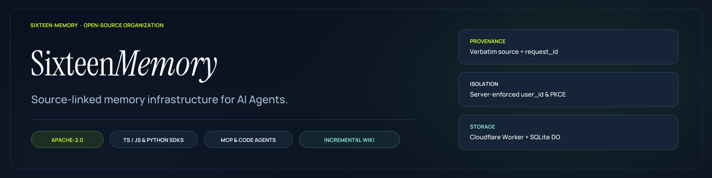

<p align="center">
  
</p>

<p align="center">
  <a href="https://github.com/Sixteen-Memory/sixteen-memory"><strong>Core Repository</strong></a> ·
  <a href="https://github.com/Sixteen-Memory/sixteen-memory/blob/main/docs/QUICKSTART.md">Quickstart</a> ·
  <a href="https://github.com/Sixteen-Memory/sixteen-memory/blob/main/docs/ARCHITECTURE.md">Architecture</a> ·
  <a href="https://www.sixteenmemory.com/?lang=en">Website (EN)</a> ·
  <a href="https://www.sixteenmemory.com/">官方网站 (中文)</a> ·
  <a href="https://github.com/Sixteen-Memory/sixteen-memory/blob/main/LICENSE">Apache-2.0</a>
</p>

---

### Memory your Agent can trust. Context that continues.

**SixteenMemory** builds open-source, source-linked memory infrastructure for AI Agents and developer applications. Instead of treating retrieved vectors as unverified truth or silently overwriting conflicting facts, SixteenMemory pairs every memory with verbatim provenance, optimistic version history, server-enforced user isolation, and incremental source-linked Wiki pages.

> **中文简介**：SixteenMemory 是面向 AI Agent 的开源记忆基础设施（Apache-2.0）。每一条记忆均保留原始来源证据与版本历史，由服务端强制执行用户隔离与权限校验，支持对话归档、按来源依赖增量更新的 Wiki 知识页，以及零守护进程的 MCP / Code Agent（Codex、Claude Code）接入；基于 Cloudflare Workers 与 SQLite Durable Objects 构建，无需额外部署向量或图数据库即可本地启动。

### What lives in [`Sixteen-Memory/sixteen-memory`](https://github.com/Sixteen-Memory/sixteen-memory)

| Module | Highlights |
| :--- | :--- |
| **[Memory &amp; Knowledge Service](https://github.com/Sixteen-Memory/sixteen-memory/tree/main/product/worker)** | Cloudflare Worker + SQLite Durable Object: versioned CRUD, bilingual FTS5 retrieval, bounded context assembly, complete conversations, incremental source-linked Wiki, and `/v1/mcp` |
| **[TypeScript / JS SDK](https://github.com/Sixteen-Memory/sixteen-memory/tree/main/product/sdk)** | Zero-dependency ESM client (`@sixteen-memory/sdk`) with OpenAPI 3.1 types, async pagination, and bounded transport |
| **[Python SDK](https://github.com/Sixteen-Memory/sixteen-memory/tree/main/product/sdk-python)** | Dependency-free synchronous client (`SixteenMemory`) and optional `httpx` native `asyncio` client (`AsyncSixteenMemory`) |
| **[Vercel AI SDK 7 Adapter](https://github.com/Sixteen-Memory/sixteen-memory/tree/main/product/integrations/vercel-ai)** | Scoped retrieval middleware (`withMemory`), read-only tools, explicit user-message writes, and `createChatHandler` |
| **[MCP &amp; Code Agents](https://github.com/Sixteen-Memory/sixteen-memory/tree/main/product/integrations/code-agents)** | Native MCP configuration and verification CLI for **Codex** and **Claude Code**, plus PKCE OAuth human-approved writes |
| **[Management Console](https://github.com/Sixteen-Memory/sixteen-memory/tree/main/product/src)** | React console for inspecting memories, verbatim sources, version diffs, Wiki conflicts, scoped API keys, and request logs |

### Try it locally in one minute

```sh
git clone https://github.com/Sixteen-Memory/sixteen-memory.git
cd sixteen-memory
npm run setup
npm run example:integration
```

Licensed under **[Apache-2.0](https://github.com/Sixteen-Memory/sixteen-memory/blob/main/LICENSE)** · Contributions, issues, and architectural discussions are welcome in [`Sixteen-Memory/sixteen-memory`](https://github.com/Sixteen-Memory/sixteen-memory/discussions).
